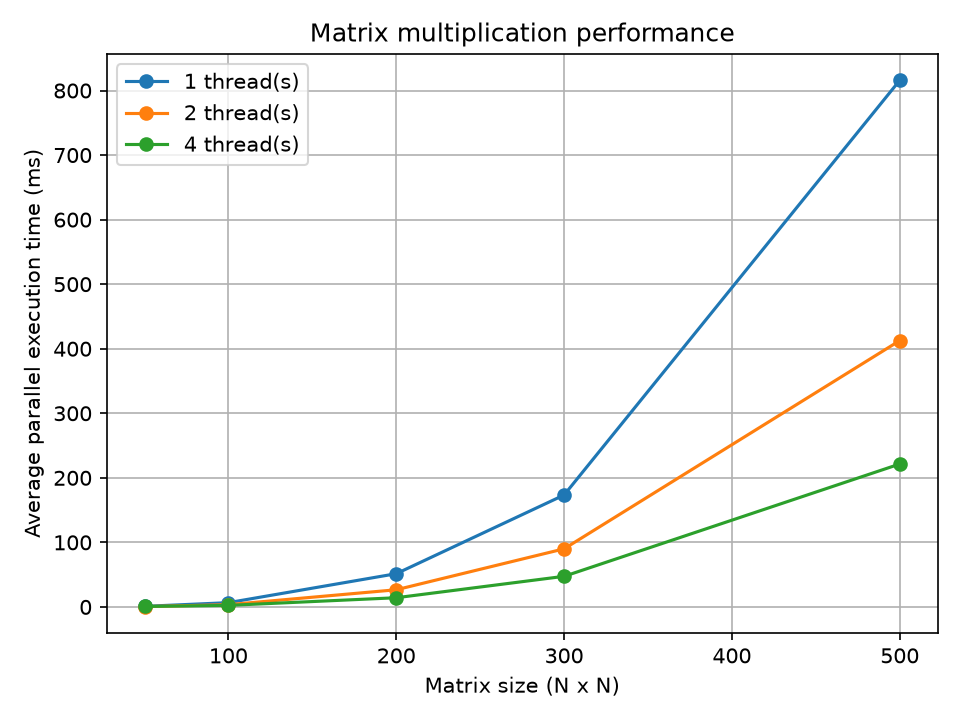

# Лабораторная работа № 1. Умножение матриц

## Задание

Написать программу на языке C++ для перемножения двух квадратных матриц.

**Входные данные:** файлы `A.txt` и `B.txt` со значениями исходных матриц.

**Выходные данные:** файл `C.txt` со значениями результирующей матрицы, время выполнения, размер задачи и количество потоков.

**Верификация:** автоматизированная проверка результатов с помощью сторонней библиотеки NumPy.

**Исследование производительности:** сравнение последовательного и параллельного умножения матриц при различном количестве потоков.

## Реализация

Программа состоит из нескольких частей:

- `gen.py` — генератор исходных матриц `A.txt` и `B.txt` заданного размера.
- `main.cpp` — программа на C++, которая считывает матрицы, вычисляет их произведение и записывает результат в `C.txt`.
- `verify.py` — проверка результата с помощью NumPy.
- `plot.py` — автоматическое проведение экспериментов, измерение времени выполнения и построение графика.
- `results.csv` — таблица результатов экспериментов.
- `performance.png` — график производительности.

Для реализации параллельных вычислений используется `std::thread`. В параллельной версии строки результирующей матрицы распределяются между потоками.

## Алгоритм умножения

Используется классический алгоритм умножения квадратных матриц. Для каждого элемента результирующей матрицы вычисляется сумма произведений соответствующих элементов исходных матриц.

Количество операций оценивается выражением:

**\(2n^3\)**

где \(n\) — размер квадратной матрицы.

Временная сложность алгоритма — **\(O(n^3)\)**.

## Методика эксперимента

- **Операционная система:** macOS.
- **Компилятор:** AppleClang.
- **Стандарт языка:** C++23.
- **Параллелизация:** `std::thread`.
- **Размеры матриц:** 50, 100, 200, 300, 500.
- **Количество потоков:** 1, 2, 4.
- **Количество повторений:** 3 для каждой комбинации размера матрицы и количества потоков.

Время выполнения для каждой комбинации рассчитывается как среднее арифметическое трёх измерений.

## Результаты экспериментов

### Таблица 1. Зависимость времени выполнения от размера матрицы

| Размер матрицы | Последовательное время, мс | 4 потока, мс | Ускорение |
| -------------: | -------------------------: | -----------: | --------: |
|        50 × 50 |                      0.926 |        0.738 |    1.256× |
|      100 × 100 |                      6.208 |        2.394 |    2.593× |
|      200 × 200 |                     46.196 |       14.237 |    3.245× |
|      300 × 300 |                    155.558 |       47.410 |    3.281× |
|      500 × 500 |                    721.580 |      221.388 |    3.259× |

Ускорение вычисляется по формуле:

\[
S=\frac{T*{\text{последовательное}}}{T*{\text{параллельное}}}
\]

где \(T\) — время выполнения программы.

### Таблица 2. Зависимость времени от количества потоков

| Размер матрицы | 1 поток, мс | 2 потока, мс | 4 потока, мс |
| -------------: | ----------: | -----------: | -----------: |
|        50 × 50 |       0.896 |        0.507 |        0.738 |
|      100 × 100 |       6.619 |        3.490 |        2.394 |
|      200 × 200 |      51.480 |       26.589 |       14.237 |
|      300 × 300 |     173.371 |       89.997 |       47.410 |
|      500 × 500 |     815.818 |      412.611 |      221.388 |

### График 1. Зависимость времени выполнения от размера матрицы



График строится скриптом `plot.py` на основании измерений времени выполнения параллельной версии программы.

## Верификация

Корректность вычислений проверяется скриптом `verify.py`. С помощью NumPy вычисляется контрольное произведение исходных матриц, которое сравнивается с результатом, сохранённым в `C.txt`.

Пример запуска:

```bash
python gen.py 100
./build/matrix 4
python verify.py
```

Проверка должна завершиться сообщением об успешном совпадении результатов.

## Выводы

В ходе лабораторной работы реализовано последовательное и параллельное умножение квадратных матриц на языке C++.

Эксперименты показывают, что с увеличением размера матриц время вычислений существенно возрастает, что соответствует кубической временной сложности классического алгоритма — \(O(n^3)\).

Для матрицы размером 500 × 500 среднее время последовательного вычисления составило 721.580 мс, а параллельного вычисления с четырьмя потоками — 221.388 мс. Получено ускорение примерно в 3.26 раза.

При использовании одного потока параллельная версия работает медленнее последовательной из-за дополнительных затрат на создание и завершение потока. При увеличении количества потоков время выполнения уменьшается, однако ускорение не является строго пропорциональным их количеству.

Корректность результатов проверяется автоматически с помощью NumPy.
